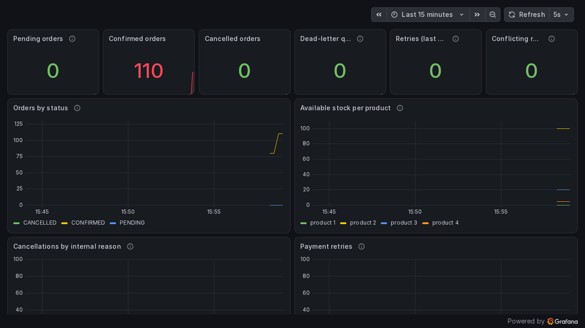
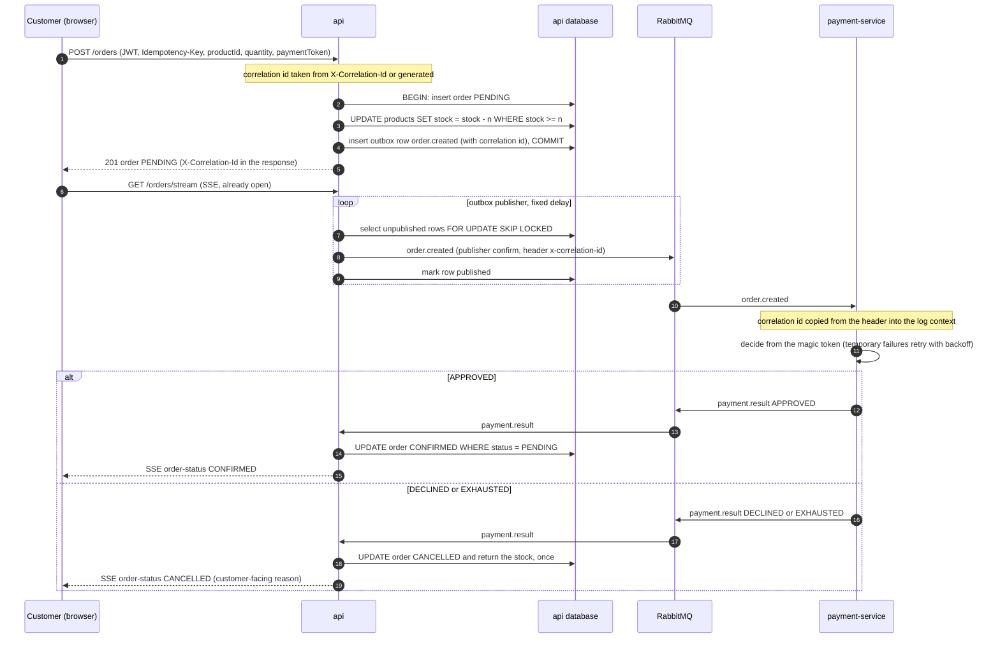

# stockrush

[English](README.md) · [Português](README.pt-BR.md)

[](https://github.com/Serg-Ale/stockrush/actions/workflows/api-ci.yml)
[](https://github.com/Serg-Ale/stockrush/actions/workflows/payment-service-ci.yml)
[](https://github.com/Serg-Ale/stockrush/actions/workflows/web-ci.yml)
[](https://github.com/Serg-Ale/stockrush/actions/workflows/e2e-ci.yml)


[](LICENSE)


**An order and payment platform with limited stock, built to answer one question: what happens when many customers fight for the last units?**

The answer, proved by tests: stock is never oversold, payments are asynchronous, temporary failures are retried with backoff, and what cannot be processed ends in a dead-letter queue instead of leaking stock.

| | |
|---|---|
| **200 buyers, 50 units** | exactly 50 orders created, 150 rejected, stock ends at 0 ([ADR 0005](docs/adr/0005-atomic-conditional-stock-decrement.md)) |
| **Two services** | `api` and `payment-service`, one database each, talking only through RabbitMQ ([ADR 0004](docs/adr/0004-two-services-with-one-database-each.md)) |
| **No lost events** | transactional outbox, at-least-once delivery, idempotent consumers ([ADR 0002](docs/adr/0002-hand-written-transactional-outbox.md)) |
| **Closed state machine** | `PENDING` leaves only to `CONFIRMED` or `CANCELLED`, and cancelling returns the stock exactly once ([ADR 0001](docs/adr/0001-payment-retry-and-dlq-policy.md)); an expiry job cancels orders that never get a result |

**Status: in development, not deployed yet.** Backend, web app, observability, the compose stack and the end-to-end test are done; Terraform and continuous deployment are still to come. Work is tracked as GitHub issues: the spec is #1 and the tickets are #2 to #37.

## See it work


*The admin demo panel firing a race from the browser.* The Grafana dashboard that the same run feeds:



## Architecture

Customers talk only to `api` (through the `web` container). Orders and stock share one database so reserving stock and creating the order is a single transaction; payment lives behind the broker. Order lifecycle and data model are in [docs/architecture.md](docs/architecture.md). The order states and the RabbitMQ retry/dead-letter topology are in [ADR 0001](docs/adr/0001-payment-retry-and-dlq-policy.md).

### Containers

*Figure 1. The containers `docker compose up` starts, and how they talk. Labels are protocol and intent; every element's source is listed below.*

```mermaid
flowchart LR
    users(["Customer / admin<br/>[person]<br/>browser"])

    subgraph stack["stockrush (docker compose)"]
        web["web<br/>[container: nginx + Angular SPA]<br/>single entry point"]
        api["api<br/>[container: Spring Boot]<br/>orders, stock, auth, outbox, SSE"]
        pay["payment-service<br/>[container: Spring Boot]<br/>decides payments, chaos control"]
        pg[("PostgreSQL 17<br/>[container: database]<br/>one database per service")]
        mq{{"RabbitMQ<br/>[container: broker]<br/>exchanges orders, payments"}}
        prom["Prometheus<br/>[container]<br/>metrics store"]
        graf["Grafana<br/>[container]<br/>business dashboard"]
    end

    users -->|"HTTP: SPA, REST + JWT"| web
    web -.->|"SSE: order-status events"| users
    web -->|"REST + JWT, SSE: orders, auth, admin race"| api
    web -->|"REST + JWT: /chaos, ADMIN only"| pay
    api -->|"JDBC: users, products, orders, outbox"| pg
    pay -->|"JDBC: one decision per order"| pg
    api -->|"AMQP: order.created via outbox"| mq
    mq -->|"AMQP: order.created, with retry and DLQ"| pay
    pay -->|"AMQP: payment.result"| mq
    mq -->|"AMQP: payment.result"| api
    prom -->|"scrape: /actuator/prometheus"| api
    prom -->|"scrape: /actuator/prometheus"| pay
    graf -->|"PromQL: dashboard queries"| prom
    users -->|"HTTP: anonymous viewer"| graf
```



| Element | Source |
|---|---|
| `web` (nginx, SPA, routing of `/chaos` and the api paths, SSE unbuffered) | `apps/web/nginx.conf`, `compose.yaml`, issue #30 |
| `api`, `payment-service`, one database each | [ADR 0004](docs/adr/0004-two-services-with-one-database-each.md), `compose.yaml` |
| `api` -> RabbitMQ through the outbox | `OutboxPublisher`, [ADR 0002](docs/adr/0002-hand-written-transactional-outbox.md) |
| Retry and DLQ on `order.created` | `OrderCreatedListener`, [ADR 0001](docs/adr/0001-payment-retry-and-dlq-policy.md) |
| `payment.result` consumed by `api` | `PaymentResultListener` (exchange `payments`) |
| SSE | `OrderEvents`, [ADR 0006](docs/adr/0006-server-sent-events-for-order-status.md) |
| Scrape targets | `infra/prometheus/prometheus.yml` (`api:8080`, `payment-service:8081`) |
| Grafana dashboard | `infra/grafana/dashboards/stockrush.json`, issue #20 |
| JWT on `/chaos` | [ADR 0007](docs/adr/0007-own-jwt-instead-of-an-identity-provider.md), `ChaosController` |

There are no external systems: the payment service is simulated and driven by magic tokens ([CONTEXT.md](CONTEXT.md)).

### The critical flow: creating an order

*Figure 2. From `POST /orders` to a confirmed or cancelled order. The correlation id travels in the outbox row and the AMQP header, so one id follows the order through both services' logs.*



| Step | Source |
|---|---|
| 1, 5 | `OrderController`, `CorrelationIdFilter` (issue #21) |
| 2-4 | `OrderService`: one transaction; conditional `UPDATE` ([ADR 0005](docs/adr/0005-atomic-conditional-stock-decrement.md)); outbox row with `correlation_id` ([ADR 0002](docs/adr/0002-hand-written-transactional-outbox.md)) |
| 6 | `OrderEvents` ([ADR 0006](docs/adr/0006-server-sent-events-for-order-status.md)) |
| 7-9 | `OutboxPublisher` (`SKIP LOCKED`, publisher confirm, header `x-correlation-id`) |
| 10-11 | `OrderCreatedListener`; retry, DLQ and the `EXHAUSTED` result in [ADR 0001](docs/adr/0001-payment-retry-and-dlq-policy.md) |
| 12-15 (`alt`) | `PaymentResultListener` -> `OrderTransitions.confirm` / `cancel`; reasons `PAYMENT_DECLINED`, `PAYMENT_UNAVAILABLE` |

## Technology

| Layer | Technology |
|---|---|
| Backend | Java 25, Spring Boot 4, Spring Security (JWT, BCrypt), Spring AMQP, JDBC |
| Data | PostgreSQL 17, Flyway |
| Messaging | RabbitMQ 4 ([ADR 0003](docs/adr/0003-rabbitmq-as-message-broker.md)) |
| Web | Angular 22, Angular Material 3, Chart.js, GSAP, Vitest |
| API contract | springdoc OpenAPI, Angular client generated with `@hey-api/openapi-ts` |
| Observability | Micrometer, Prometheus, Grafana |
| Tests | JUnit and Testcontainers, Vitest, Playwright |
| Delivery | Docker Compose, GitHub Actions (Terraform and AWS: planned) |

Decisions behind these choices are in [docs/adr](docs/adr): [own JWT](docs/adr/0007-own-jwt-instead-of-an-identity-provider.md), [module boundaries and Spring Modulith](docs/adr/0008-module-boundaries-by-package-spring-modulith-deferred.md), and the ones linked above.

## Quick start

```bash
docker compose up --build
```

One command brings up PostgreSQL (one database per service), RabbitMQ, `payment-service`, `api`, the web app, Prometheus and Grafana, each starting only after what it depends on is healthy. Open http://localhost:8000 and sign in as `admin@stockrush.demo` with the demo password `demo-admin-123`; the admin menu has the demo panel, which fires a race and tunes the chaos control. The `web` container is the only entry point. Other ports: Grafana on 3000 (anonymous viewer), Prometheus on 9090, RabbitMQ management on 15672.

`JWT_SECRET` and `DEMO_ADMIN_PASSWORD` have local-only defaults in `compose.yaml`; override them with a `.env` file or the environment, and never reuse the defaults anywhere public.

## Running the tests

You need **JDK 25** and **Docker** (PostgreSQL and RabbitMQ run in Testcontainers). From the repository root:

```bash
./apps/payment-service/mvnw -f apps/payment-service/pom.xml package
```

```bash
./apps/api/mvnw -f apps/api/pom.xml verify
```

The first command also builds the payment-service jar. The `api` suite includes a two-service end-to-end test that starts that jar as a child process; **without the jar this test is skipped**, so build it first (CI does). No JDK 25 locally? Run the same Maven goals inside the `maven:3-eclipse-temurin-25` image with the Docker socket mounted.

Web unit tests:

```bash
cd apps/web && npm ci && npx ng test --watch=false
```

End-to-end, with the stack up (`docker compose up --build --wait`): the test signs in as the demo admin, fires a race from the panel and checks that sold plus rejected equals the number of buyers and the final stock matches; it also checks that a regular customer gets no panel. Set `E2E_BASE_URL` or `E2E_ADMIN_PASSWORD` if you changed the defaults.

```bash
cd e2e && npm ci && npx playwright install chromium && npx playwright test
```

The `api-ci`, `payment-service-ci`, `web-ci` and `e2e-ci` workflows run all of this on every push.

### Coverage

JaCoCo runs with `verify` and writes `target/site/jacoco/index.html` in each service; CI prints the totals in the job summary and uploads the HTML report as an artifact. Measured on 2026-11-19 (JDK 25, full suites):

| Service | Instructions | Branches | Lines |
|---|---|---|---|
| `api` | 96.1% | 81.5% | 94.3% |
| `payment-service` | 95.3% | 84.4% | 94.6% |

These numbers are a snapshot, not a gate: the current figures are in the latest CI run.

## Developing

Run the services outside Docker with the api on port 8080 and `payment-service` on 8081. Both need `JWT_SECRET` (the same value, at least 32 bytes) and PostgreSQL and RabbitMQ configured through the `DB_*` and `RABBITMQ_*` variables in each `application.properties`; the `api` creates the demo admin only if `DEMO_ADMIN_PASSWORD` is set. Then:

```bash
cd apps/web && npm ci && npm start
```

`npm start` serves on http://localhost:4200 and proxies the api routes to 8080 and `/chaos` to 8081 (`proxy.conf.json`).

The api publishes its OpenAPI document at `/v3/api-docs`. A snapshot is committed as `apps/api/openapi.json`, `OpenApiContractTests` fails when the running api no longer matches it, and the Angular client in `apps/web/src/app/api` is generated from it (`web-ci` fails on any difference). After changing a controller:

```bash
./apps/api/mvnw -f apps/api/pom.xml test -Dtest=OpenApiContractTests -Dopenapi.update=true
```

```bash
cd apps/web && npm run generate:api
```

## What works today

- **Orders with atomic stock reservation.** `POST /orders` reserves stock with one conditional `UPDATE` and creates the order in the same transaction. A test with 200 concurrent buyers for 50 units sells exactly 50.
- **Idempotent creation.** `Idempotency-Key` is required; a replay returns the same order and never reserves twice.
- **Transactional outbox to RabbitMQ**, relayed with `FOR UPDATE SKIP LOCKED` ([ADR 0002](docs/adr/0002-hand-written-transactional-outbox.md)).
- **A second service for payments**, driven by magic tokens: `tok_approve`, `tok_decline`, `tok_flaky` (approved on the 3rd attempt), `tok_slow` and `tok_dead` (always exhausts).
- **Retries, dead-letter queue and a closed state machine.** Backoff of 1, 2 and 4 s over wait queues; when attempts run out the order is cancelled and its stock returned once. An expiry job cancels `PENDING` orders older than 2 minutes (`EXPIRED`) as a safety net. A late result that contradicts a final order is discarded and counted.
- **Real-time status over SSE**, own-orders-only reads, JWT auth with `CLIENTE` and `ADMIN` roles, rate limiting, and correlation ids across the queue.
- **Chaos control** (`/chaos`, admin only): failure rate and `tok_slow` latency change at runtime, from the demo panel.
- **Business metrics** in Prometheus and a Grafana dashboard: pending, confirmed and cancelled orders and dead-letter queue depth.

## Repository layout

| Path | What it is |
|---|---|
| `apps/api` | Orders, stock, auth, outbox publisher, payment result consumer, SSE (Spring Boot, PostgreSQL, Flyway) |
| `apps/payment-service` | Simulated payment service with its own database (Spring Boot) |
| `apps/web` | Angular web app and its nginx container |
| `e2e` | Playwright tests against the compose stack |
| `compose.yaml`, `infra` | Compose stack, Prometheus and Grafana configuration (Terraform not started) |
| `docs` | [Architecture](docs/architecture.md), [ADRs](docs/adr), [discovery](docs/discovery.md) (decisions, pt-BR), [backlog](docs/BACKLOG.md) (V2), [glossary](CONTEXT.md) |

## How the work is organized

Decisions are written down before and after the code: a spec (#1), tracer-bullet tickets with acceptance criteria and blockers, one pull request per ticket, and ADRs that cite the evidence (for example the 200x50 test result). The terms used in code and docs are defined in [CONTEXT.md](CONTEXT.md).

## License

[MIT](LICENSE)
