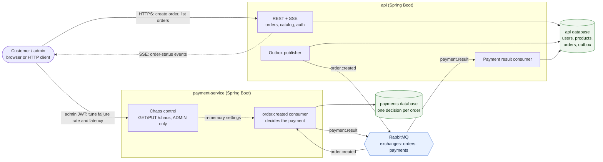

# stockrush

[](https://github.com/Serg-Ale/stockrush/actions/workflows/api-ci.yml)
[](https://github.com/Serg-Ale/stockrush/actions/workflows/payment-service-ci.yml)


[](LICENSE)


**An order and payment platform with limited stock, built to answer one question: what happens when many customers fight for the last units?**

The answer, proved by tests: stock is never oversold, payments are asynchronous, temporary failures are retried with backoff, and what cannot be processed ends in a dead-letter queue instead of leaking stock.

| | |
|---|---|
| **200 buyers, 50 units** | exactly 50 orders created, 150 rejected, stock ends at 0 ([ADR 0005](docs/adr/0005-atomic-conditional-stock-decrement.md)) |
| **Two services** | `api` and `payment-service`, one database each, talking only through RabbitMQ ([ADR 0004](docs/adr/0004-two-services-with-one-database-each.md)) |
| **No lost events** | transactional outbox, at-least-once delivery, idempotent consumers ([ADR 0002](docs/adr/0002-hand-written-transactional-outbox.md)) |
| **Closed state machine** | `PENDING` leaves only to `CONFIRMED` or `CANCELLED`, and cancelling returns the stock exactly once ([ADR 0001](docs/adr/0001-payment-retry-and-dlq-policy.md)); the expiry job for orders that never get a result is ticket #35 |

**Status: in development, not deployed yet.** The backend works end to end; the web app, observability, compose setup and deployment are still to come. Work is tracked as GitHub issues: the spec is #1 and the tickets are #2 to #37.

## Architecture at a glance

Customers talk only to `api`. Orders and stock share one database so reserving stock and creating the order is a single transaction; payment lives behind the broker. More views (order lifecycle, data model) are in [docs/architecture.md](docs/architecture.md), which is the source of truth for the diagrams.



## What works today

- **Orders with atomic stock reservation.** `POST /orders` reserves stock with one conditional `UPDATE` and creates the order in the same transaction. A test with 200 concurrent buyers for 50 units sells exactly 50 ([ADR 0005](docs/adr/0005-atomic-conditional-stock-decrement.md)).
- **Idempotent creation.** `Idempotency-Key` is required; a replay returns the same order and never reserves twice.
- **Transactional outbox to RabbitMQ.** The `order.created` event is written with the reservation and relayed with `FOR UPDATE SKIP LOCKED` ([ADR 0002](docs/adr/0002-hand-written-transactional-outbox.md), [ADR 0003](docs/adr/0003-rabbitmq-as-message-broker.md)).
- **A second service for payments** with its own database ([ADR 0004](docs/adr/0004-two-services-with-one-database-each.md)), driven by magic tokens: `tok_approve`, `tok_decline`, `tok_flaky` (approved on the 3rd attempt), `tok_slow` and `tok_dead` (always exhausts).
- **Retries, dead-letter queue and a closed state machine.** Backoff of 1, 2 and 4 s over wait queues; when attempts run out the order is cancelled and its stock returned once. A late result that contradicts a final order is discarded and counted ([ADR 0001](docs/adr/0001-payment-retry-and-dlq-policy.md)).
- **Real-time status over SSE** ([ADR 0006](docs/adr/0006-server-sent-events-for-order-status.md)), own-orders-only reads, JWT auth with `CLIENTE` and `ADMIN` roles, rate limiting, and a runtime chaos control (`/chaos`, admin only) for failure rate and latency.

How the pieces fit is in [docs/architecture.md](docs/architecture.md): system context, the order lifecycle and the data model.

## Repository layout

| Path | What it is |
|---|---|
| `apps/api` | Orders, stock, auth, outbox publisher, payment result consumer, SSE (Spring Boot, PostgreSQL, Flyway) |
| `apps/payment-service` | Simulated payment service with its own PostgreSQL (Spring Boot) |
| `apps/web` | Web app (Angular), not started |
| `infra` | Compose and Terraform, not started |
| `docs` | [Architecture](docs/architecture.md), [ADRs](docs/adr), [discovery](docs/discovery.md) (decisions, pt-BR), [backlog](docs/BACKLOG.md) (V2), [glossary](CONTEXT.md) |

## Running the tests

You need **JDK 25** and **Docker** (PostgreSQL and RabbitMQ run in Testcontainers). From the repository root:

```bash
./apps/payment-service/mvnw -f apps/payment-service/pom.xml package
```

```bash
./apps/api/mvnw -f apps/api/pom.xml verify
```

The first command also builds the payment-service jar. The `api` suite includes a two-service end-to-end test that starts that jar as a child process; **without the jar this test is skipped**, so build it first (CI does).

No JDK 25 locally? Run the same Maven goals inside the `maven:3-eclipse-temurin-25` image with the Docker socket mounted.

## API contract and web client

The api publishes its OpenAPI document at `/v3/api-docs`, generated from the controllers. A snapshot is committed as `apps/api/openapi.json`, and `OpenApiContractTests` fails when the running api no longer matches it. The Angular client in `apps/web/src/app/api` is generated from that snapshot and committed; the `web-ci` workflow regenerates it and fails on any difference.

After changing a controller:

```bash
./apps/api/mvnw -f apps/api/pom.xml test -Dtest=OpenApiContractTests -Dopenapi.update=true
```

```bash
cd apps/web && npm ci && npm run generate:api
```

## Web app

Angular 22 with Angular Material (Material 3 theme), Portuguese UI, signals and Vitest. Sign-up, login, the auth guard, the product catalog and order creation (with an `Idempotency-Key`) work against the api; the live order list updates over SSE and reconnects by itself. With the api running on port 8080:

```bash
cd apps/web && npm ci && npm start
```

`npm start` serves on http://localhost:4200 and proxies the api routes to port 8080 (`proxy.conf.json`). `npx ng test --watch=false` runs the unit tests.

## Running the services

Both services need `JWT_SECRET` (the same value, at least 32 bytes). The `api` creates the demonstration admin `admin@stockrush.demo` only if `DEMO_ADMIN_PASSWORD` is set. A one-command `docker compose up` is planned in ticket #30; until then you must provide PostgreSQL (one database per service) and RabbitMQ yourself, configured through the `DB_*` and `RABBITMQ_*` variables in each `application.properties`.

## Stack

Java 25 · Spring Boot 4 · PostgreSQL · Flyway · RabbitMQ · Testcontainers · GitHub Actions. Planned: Angular, Docker Compose, Prometheus and Grafana, Terraform, AWS.

## How the work is organized

Decisions are written down before and after the code: a spec (#1), tracer-bullet tickets with acceptance criteria and blockers, one pull request per ticket, and ADRs that cite the evidence (for example the 200×50 test result). The terms used in code and docs are defined in [CONTEXT.md](CONTEXT.md).

## License

[MIT](LICENSE)
