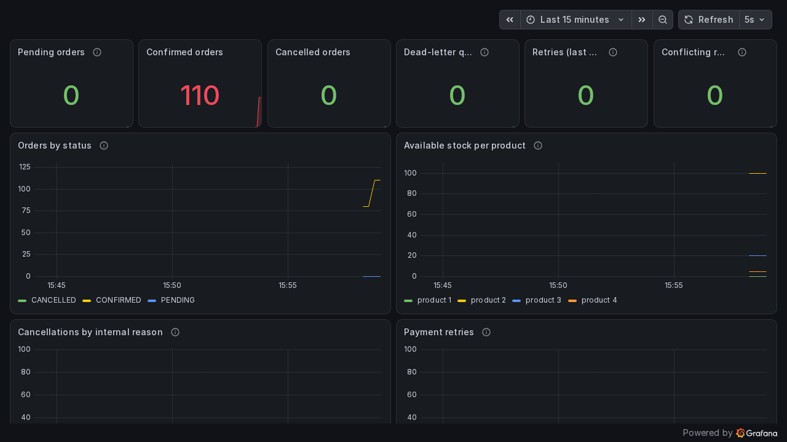
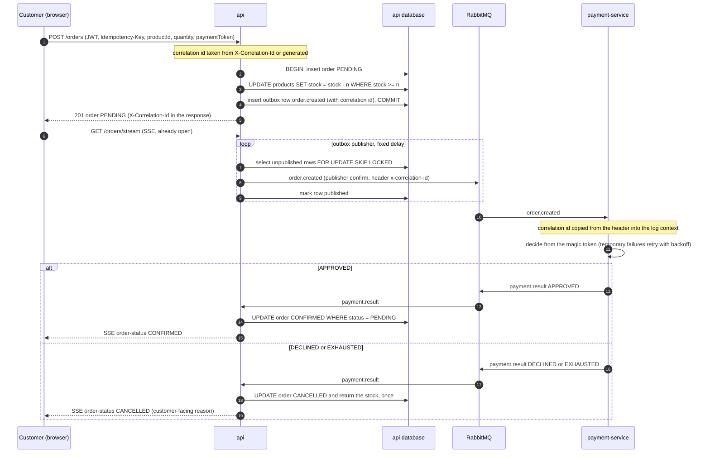

# stockrush

[English](README.md) · [Português](README.pt-BR.md)

[](https://github.com/Serg-Ale/stockrush/actions/workflows/api-ci.yml)
[](https://github.com/Serg-Ale/stockrush/actions/workflows/payment-service-ci.yml)
[](https://github.com/Serg-Ale/stockrush/actions/workflows/web-ci.yml)
[](https://github.com/Serg-Ale/stockrush/actions/workflows/e2e-ci.yml)


[](LICENSE)


**Uma plataforma de pedidos e pagamentos com estoque limitado, feita para responder a uma pergunta: o que acontece quando muitos clientes disputam as últimas unidades?**

A resposta, provada por testes: o estoque nunca é vendido além do que existe, o pagamento é assíncrono, falhas temporárias são retentadas com backoff, e o que não pode ser processado termina numa fila de mensagens mortas (DLQ) em vez de vazar estoque.

| | |
|---|---|
| **200 compradores, 50 unidades** | exatamente 50 pedidos criados, 150 rejeitados, estoque termina em 0 ([ADR 0005](docs/adr/0005-atomic-conditional-stock-decrement.md)) |
| **Dois serviços** | `api` e `payment-service`, um banco para cada, conversando só pelo RabbitMQ ([ADR 0004](docs/adr/0004-two-services-with-one-database-each.md)) |
| **Nenhum evento perdido** | outbox transacional, entrega at-least-once, consumidores idempotentes ([ADR 0002](docs/adr/0002-hand-written-transactional-outbox.md)) |
| **Máquina de estados fechada** | `PENDING` só sai para `CONFIRMED` ou `CANCELLED`, e cancelar devolve o estoque exatamente uma vez ([ADR 0001](docs/adr/0001-payment-retry-and-dlq-policy.md)); um job de expiração cancela pedidos que nunca recebem resultado |

**Status: em desenvolvimento, ainda sem deploy.** Backend, app web, observabilidade, o stack do compose e o teste ponta a ponta estão prontos; Terraform e entrega contínua ainda faltam. O trabalho é acompanhado em issues do GitHub: a spec é a #1 e os tickets vão da #2 à #37. Os ADRs, o glossário e o código estão em inglês; as explicações abaixo estão em português.

## Veja funcionando


*O painel de demonstração do admin disparando uma disputa no navegador.* O dashboard do Grafana alimentado pela mesma execução:



## Arquitetura

O cliente fala só com a `api` (pelo contêiner `web`). Pedidos e estoque ficam no mesmo banco para que reservar o estoque e criar o pedido seja uma transação só; o pagamento fica atrás do broker. O ciclo de vida do pedido e o modelo de dados estão em [docs/architecture.md](docs/architecture.md). Os estados do pedido e a topologia de retentativa e DLQ do RabbitMQ estão no [ADR 0001](docs/adr/0001-payment-retry-and-dlq-policy.md).

### Contêineres

*Figura 1. Os contêineres que o `docker compose up` sobe e como conversam. Os rótulos são protocolo e intenção; a origem de cada elemento está na tabela abaixo. Os rótulos do diagrama ficam em inglês, como no README em inglês.*

```mermaid
flowchart LR
    users(["Customer / admin<br/>[person]<br/>browser"])

    subgraph stack["stockrush (docker compose)"]
        web["web<br/>[container: nginx + Angular SPA]<br/>single entry point"]
        api["api<br/>[container: Spring Boot]<br/>orders, stock, auth, outbox, SSE"]
        pay["payment-service<br/>[container: Spring Boot]<br/>decides payments, chaos control"]
        pg[("PostgreSQL 17<br/>[container: database]<br/>one database per service")]
        mq{{"RabbitMQ<br/>[container: broker]<br/>exchanges orders, payments"}}
        prom["Prometheus<br/>[container]<br/>metrics store"]
        graf["Grafana<br/>[container]<br/>business dashboard"]
    end

    users -->|"HTTP: SPA, REST + JWT"| web
    web -.->|"SSE: order-status events"| users
    web -->|"REST + JWT, SSE: orders, auth, admin race"| api
    web -->|"REST + JWT: /chaos, ADMIN only"| pay
    api -->|"JDBC: users, products, orders, outbox"| pg
    pay -->|"JDBC: one decision per order"| pg
    api -->|"AMQP: order.created via outbox"| mq
    mq -->|"AMQP: order.created, with retry and DLQ"| pay
    pay -->|"AMQP: payment.result"| mq
    mq -->|"AMQP: payment.result"| api
    prom -->|"scrape: /actuator/prometheus"| api
    prom -->|"scrape: /actuator/prometheus"| pay
    graf -->|"PromQL: dashboard queries"| prom
    users -->|"HTTP: anonymous viewer"| graf
```



| Elemento | Origem |
|---|---|
| `web` (nginx, SPA, roteamento de `/chaos` e das rotas da api, SSE sem buffer) | `apps/web/nginx.conf`, `compose.yaml`, issue #30 |
| `api`, `payment-service`, um banco para cada | [ADR 0004](docs/adr/0004-two-services-with-one-database-each.md), `compose.yaml` |
| `api` -> RabbitMQ pelo outbox | `OutboxPublisher`, [ADR 0002](docs/adr/0002-hand-written-transactional-outbox.md) |
| Retentativa e DLQ em `order.created` | `OrderCreatedListener`, [ADR 0001](docs/adr/0001-payment-retry-and-dlq-policy.md) |
| `payment.result` consumido pela `api` | `PaymentResultListener` (exchange `payments`) |
| SSE | `OrderEvents`, [ADR 0006](docs/adr/0006-server-sent-events-for-order-status.md) |
| Alvos de scrape | `infra/prometheus/prometheus.yml` (`api:8080`, `payment-service:8081`) |
| Dashboard do Grafana | `infra/grafana/dashboards/stockrush.json`, issue #20 |
| JWT em `/chaos` | [ADR 0007](docs/adr/0007-own-jwt-instead-of-an-identity-provider.md), `ChaosController` |

Não há sistemas externos: o serviço de pagamento é simulado e controlado por tokens mágicos ([CONTEXT.md](CONTEXT.md)).

### O fluxo crítico: criar um pedido

*Figura 2. De `POST /orders` até um pedido confirmado ou cancelado. O correlation id viaja na linha do outbox e no header AMQP, então um único id acompanha o pedido nos logs dos dois serviços.*



| Passo | Origem |
|---|---|
| 1, 5 | `OrderController`, `CorrelationIdFilter` (issue #21) |
| 2-4 | `OrderService`: uma transação; `UPDATE` condicional ([ADR 0005](docs/adr/0005-atomic-conditional-stock-decrement.md)); linha do outbox com `correlation_id` ([ADR 0002](docs/adr/0002-hand-written-transactional-outbox.md)) |
| 6 | `OrderEvents` ([ADR 0006](docs/adr/0006-server-sent-events-for-order-status.md)) |
| 7-9 | `OutboxPublisher` (`SKIP LOCKED`, confirmação do publicador, header `x-correlation-id`) |
| 10-11 | `OrderCreatedListener`; retentativa, DLQ e o resultado `EXHAUSTED` no [ADR 0001](docs/adr/0001-payment-retry-and-dlq-policy.md) |
| 12-15 (`alt`) | `PaymentResultListener` -> `OrderTransitions.confirm` / `cancel`; motivos `PAYMENT_DECLINED`, `PAYMENT_UNAVAILABLE` |

## Tecnologias

| Camada | Tecnologia |
|---|---|
| Backend | Java 25, Spring Boot 4, Spring Security (JWT, BCrypt), Spring AMQP, JDBC |
| Dados | PostgreSQL 17, Flyway |
| Mensageria | RabbitMQ 4 ([ADR 0003](docs/adr/0003-rabbitmq-as-message-broker.md)) |
| Web | Angular 22, Angular Material 3, Chart.js, GSAP, Vitest |
| Contrato da API | OpenAPI do springdoc, cliente Angular gerado com `@hey-api/openapi-ts` |
| Observabilidade | Micrometer, Prometheus, Grafana |
| Testes | JUnit e Testcontainers, Vitest, Playwright |
| Entrega | Docker Compose, GitHub Actions (Terraform e AWS: planejados) |

As decisões por trás das escolhas estão em [docs/adr](docs/adr): [JWT próprio](docs/adr/0007-own-jwt-instead-of-an-identity-provider.md), [fronteiras de módulo e Spring Modulith](docs/adr/0008-module-boundaries-by-package-spring-modulith-deferred.md) e os ADRs citados acima.

## Como rodar

```bash
docker compose up --build
```

Um comando sobe PostgreSQL (um banco por serviço), RabbitMQ, `payment-service`, `api`, o app web, Prometheus e Grafana, cada um só começando depois que o que ele usa estiver saudável. Abra http://localhost:8000 e entre como `admin@stockrush.demo` com a senha de demonstração `demo-admin-123`; o menu do admin tem o painel de demonstração, que dispara uma disputa e ajusta o controle de caos. O contêiner `web` é a única porta de entrada. Outras portas: Grafana em 3000 (visitante anônimo), Prometheus em 9090, console do RabbitMQ em 15672.

`JWT_SECRET` e `DEMO_ADMIN_PASSWORD` têm valores padrão só para uso local no `compose.yaml`; sobrescreva com um arquivo `.env` ou com o ambiente, e nunca reutilize os padrões em nada público.

## Rodando os testes

Você precisa de **JDK 25** e **Docker** (PostgreSQL e RabbitMQ rodam no Testcontainers). Na raiz do repositório:

```bash
./apps/payment-service/mvnw -f apps/payment-service/pom.xml package
```

```bash
./apps/api/mvnw -f apps/api/pom.xml verify
```

O primeiro comando também gera o jar do payment-service. A suíte da `api` inclui um teste ponta a ponta com os dois serviços que sobe esse jar como processo filho; **sem o jar esse teste é ignorado**, então gere-o antes (a CI faz isso). Sem JDK 25 local? Rode os mesmos goals do Maven dentro da imagem `maven:3-eclipse-temurin-25` com o socket do Docker montado.

Testes unitários do web:

```bash
cd apps/web && npm ci && npx ng test --watch=false
```

Ponta a ponta, com o stack no ar (`docker compose up --build --wait`): o teste entra como admin de demonstração, dispara uma disputa pelo painel e confere que vendidos mais rejeitados é igual ao número de compradores e que o estoque final bate; também confere que um cliente comum não recebe o painel. Defina `E2E_BASE_URL` ou `E2E_ADMIN_PASSWORD` se mudou os padrões.

```bash
cd e2e && npm ci && npx playwright install chromium && npx playwright test
```

Os workflows `api-ci`, `payment-service-ci`, `web-ci` e `e2e-ci` rodam tudo isso a cada push.

### Cobertura

O JaCoCo roda no `verify` e gera `target/site/jacoco/index.html` em cada serviço; a CI imprime os totais no resumo do job e guarda o relatório HTML como artefato. Medido em 19/11/2026 (JDK 25, suítes completas):

| Serviço | Instruções | Branches | Linhas |
|---|---|---|---|
| `api` | 96,1% | 81,5% | 94,3% |
| `payment-service` | 95,3% | 84,4% | 94,6% |

Os números são uma fotografia, não um portão: os valores atuais estão na última execução da CI.

## Desenvolvimento

Rode os serviços fora do Docker com a api na porta 8080 e o `payment-service` na 8081. Ambos precisam de `JWT_SECRET` (o mesmo valor, ao menos 32 bytes) e de PostgreSQL e RabbitMQ configurados pelas variáveis `DB_*` e `RABBITMQ_*` de cada `application.properties`; a `api` só cria o admin de demonstração se `DEMO_ADMIN_PASSWORD` estiver definido. Depois:

```bash
cd apps/web && npm ci && npm start
```

O `npm start` serve em http://localhost:4200 e encaminha as rotas da api para 8080 e `/chaos` para 8081 (`proxy.conf.json`).

A api publica o documento OpenAPI em `/v3/api-docs`. Um snapshot fica commitado em `apps/api/openapi.json`, o `OpenApiContractTests` falha quando a api deixa de bater com ele, e o cliente Angular em `apps/web/src/app/api` é gerado a partir dele (o `web-ci` falha em qualquer diferença). Depois de mudar um controller:

```bash
./apps/api/mvnw -f apps/api/pom.xml test -Dtest=OpenApiContractTests -Dopenapi.update=true
```

```bash
cd apps/web && npm run generate:api
```

## O que funciona hoje

- **Pedidos com reserva atômica de estoque.** `POST /orders` reserva o estoque com um único `UPDATE` condicional e cria o pedido na mesma transação. Um teste com 200 compradores simultâneos para 50 unidades vende exatamente 50.
- **Criação idempotente.** O `Idempotency-Key` é obrigatório; repetir a chamada devolve o mesmo pedido e nunca reserva duas vezes.
- **Outbox transacional para o RabbitMQ**, repassado com `FOR UPDATE SKIP LOCKED` ([ADR 0002](docs/adr/0002-hand-written-transactional-outbox.md)).
- **Um segundo serviço de pagamentos**, controlado por tokens mágicos: `tok_approve`, `tok_decline`, `tok_flaky` (aprovado na 3ª tentativa), `tok_slow` e `tok_dead` (sempre esgota).
- **Retentativas, fila de mensagens mortas e máquina de estados fechada.** Backoff de 1, 2 e 4 s em filas de espera; quando as tentativas acabam, o pedido é cancelado e o estoque devolvido uma vez. Um job de expiração cancela pedidos `PENDING` com mais de 2 minutos (`EXPIRED`) como rede de segurança. Um resultado tardio que contradiz um pedido final é descartado e contado.
- **Status em tempo real por SSE**, leitura só dos próprios pedidos, autenticação JWT com os papéis `CLIENTE` e `ADMIN`, limite de taxa e correlation id atravessando a fila.
- **Controle de caos** (`/chaos`, só ADMIN): taxa de falha e latência do `tok_slow` mudam em tempo de execução, pelo painel de demonstração.
- **Métricas de negócio** no Prometheus e um dashboard do Grafana: pedidos pendentes, confirmados e cancelados e profundidade da fila de mensagens mortas.

## Estrutura do repositório

| Caminho | O que é |
|---|---|
| `apps/api` | Pedidos, estoque, autenticação, publicador do outbox, consumidor de resultados de pagamento, SSE (Spring Boot, PostgreSQL, Flyway) |
| `apps/payment-service` | Serviço de pagamento simulado com banco próprio (Spring Boot) |
| `apps/web` | App web em Angular e seu contêiner nginx |
| `e2e` | Testes Playwright contra o stack do compose |
| `compose.yaml`, `infra` | Stack do compose, configuração do Prometheus e do Grafana (Terraform ainda não começou) |
| `docs` | [Arquitetura](docs/architecture.md), [ADRs](docs/adr), [discovery](docs/discovery.md) (decisões, em pt-BR), [backlog](docs/BACKLOG.md) (V2), [glossário](CONTEXT.md) |

## Como o trabalho é organizado

As decisões são escritas antes e depois do código: uma spec (#1), tickets tracer-bullet com critérios de aceite e bloqueios, um pull request por ticket, e ADRs que citam a evidência (por exemplo o resultado do teste 200x50). Os termos usados no código e nos documentos estão definidos em [CONTEXT.md](CONTEXT.md).

## Licença

[MIT](LICENSE)
