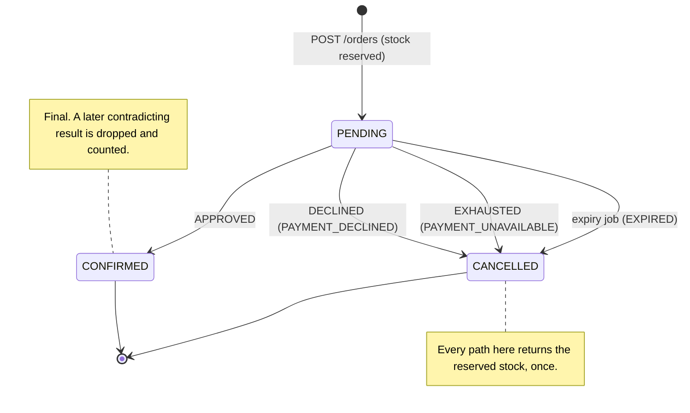
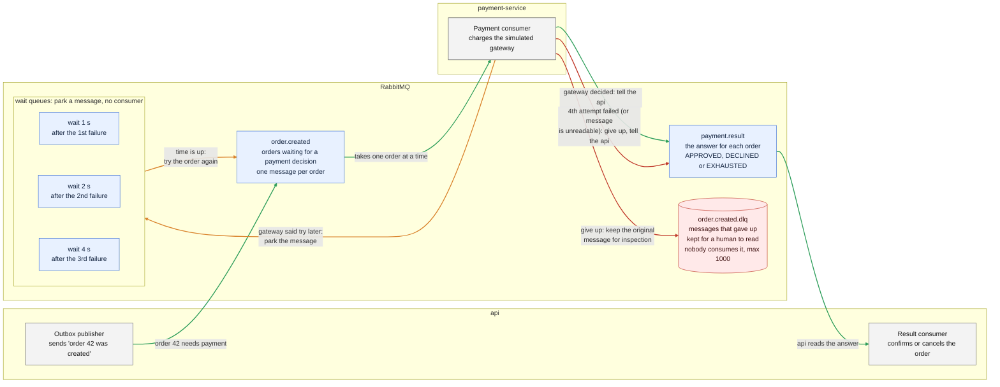
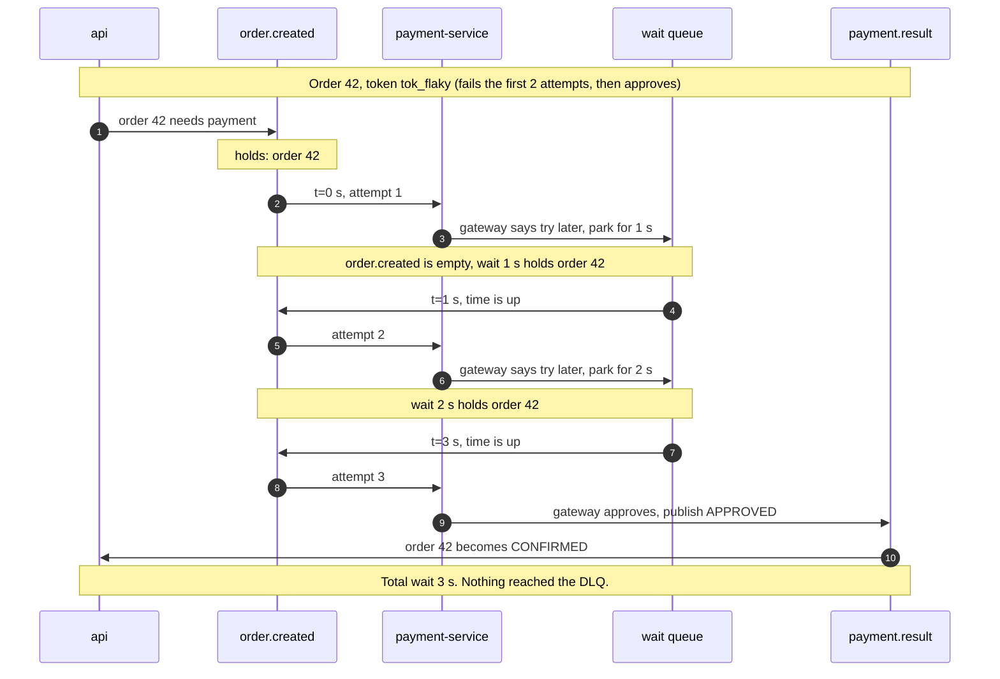
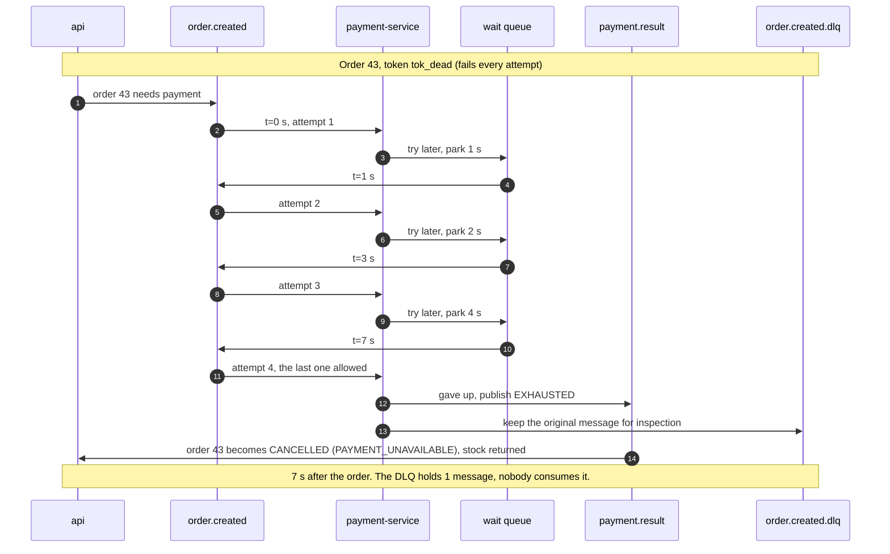

# 0001. Payment retry, dead-letter queue and order cancellation policy

- Status: accepted
- Date: 2026-11-16
- Resolves: the open point of issue #1 (story 13) and the "exact policy" left to issue #15

## Context

`api` reserves stock when an order is created (`PENDING`) and publishes an
`order.created` event through the transactional outbox. `payment-service`
decides the payment asynchronously. Some failures are temporary, so the
message is retried with backoff and, when attempts run out, dead-lettered.

Three things were undecided: what happens to the order when attempts run out,
who tells `api`, and what happens when results arrive out of order. Leaving
`PENDING` orders holding reserved stock forever would break the project's
central claim (no stock leaks), so the policy has to close every path that
ends an order.

## Decision

1. **Terminal state.** An order whose payment cannot be completed ends in
   `CANCELLED`, with the reserved stock returned and a `reason`. No new state.
2. **Who signals `api`.** When attempts run out, `payment-service` publishes
   an `EXHAUSTED` result on the same result queue as `APPROVED` and `DECLINED`,
   then dead-letters the original message. `api` handles it with the same
   idempotent consumer that cancels on `DECLINED` and returns stock. `api` does
   not consume the DLQ and knows nothing about `payment-service` internals.
3. **First result wins.** A terminal order state is final. A later result that
   contradicts it (for example `APPROVED` after `CANCELLED`) is discarded,
   logged with the correlation id and counted in
   `payment_conflicting_results_total`. The order is never reopened, because
   its stock may already belong to another customer. In a real system this
   case needs a refund or reconciliation, which is out of scope.
4. **Retry mechanism.** Wait queues with a per-message TTL, one per backoff
   step, each dead-lettering back to the main queue. Nothing blocks a consumer
   thread. The attempt number comes from the broker's own header, so
   `payment-service` keeps no retry state in its database. Implementation note
   (2026-11-17): RabbitMQ 4 drops a client-set `x-death` when the consumer
   republishes the message to the next wait queue, so the accumulated `x-death`
   count is always 1. The service reads `x-last-death-queue` instead: the wait
   queue the message just came back from (`order.created.wait.N`) means attempt
   N + 1. The main queue is `order.created`, not `payment.requested`.
5. **Numbers.** 4 attempts in total (the original plus 3 retries), with
   steps of 1 s, 2 s and 4 s: at most about 7 s before cancellation. The
   steps and the attempt limit are Spring properties with these defaults,
   because tests must shorten them. `tok_flaky` fails its first 2 attempts and
   is approved on the 3rd.
6. **Deterministic exhaustion.** A fifth magic token, `tok_dead`, fails
   temporarily on every attempt and always exhausts. The runtime chaos control
   (issue #16) cannot be the trigger, because it comes after the DLQ in the
   ticket graph.
7. **DLQ is for inspection only.** Nothing consumes it and there is no replay
   in v1: the order is already cancelled when the message lands there, so a
   replayed result would be discarded by rule 3. The queue is capped at 1000
   messages (`x-max-length`) so the public demo cannot grow it without bound,
   and its depth is exported as a Prometheus metric. Replay goes to
   `docs/BACKLOG.md`, to be revisited together with reconciliation.
8. **Permanent errors skip the retry steps.** A message that can never
   succeed (invalid JSON, missing `orderId`, invalid values) is rejected
   without requeue and goes straight to the DLQ, with the cause in a header.
   If the `orderId` is readable, `payment-service` publishes `EXHAUSTED` with
   internal reason `INVALID_MESSAGE`. If not, there is no order to cancel and
   only the DLQ and the metric record it. Implementation note (2026-11-19):
   the cause is the `x-failure-cause` header of the dead-lettered copy, the
   result carries `reason: INVALID_MESSAGE` for `api`, and
   `payment_permanent_failures_total` counts these messages.
9. **Expiry safety net.** The DLQ only covers messages that fail. If
   `payment-service` is down, the outbox is stuck or the broker is gone, the
   message just waits and the order stays `PENDING`. A scheduled job in `api`
   cancels `PENDING` orders older than a limit (default 2 minutes, a Spring
   property) with internal reason `TIMEOUT` and returns the stock through the
   same idempotent transition. The limit must stay above the worst legitimate
   case: the retry steps (about 7 s) plus the maximum configured `tok_slow`
   latency. An order cancelled while only slow produces a late result, which
   rule 3 discards and counts.
10. **What the customer sees.** The API and SSE expose a stable three-value
    enum, `cancellationReason`: `PAYMENT_DECLINED`, `PAYMENT_UNAVAILABLE` and
    `EXPIRED`. `PAYMENT_UNAVAILABLE` covers both `EXHAUSTED` and
    `INVALID_MESSAGE`. The finer internal reason lives in a non-exposed column,
    in logs and in metrics. The Angular app translates the enum into Portuguese.

## Order state machine

A result arriving in a terminal state is not a transition: it is dropped and
counted (rule 3).

## Retry and dead-letter topology

Legend: green is the happy path, orange is the retry loop, red is the dead end.
The wait queues are tried in order (1 s, then 2 s, then 4 s), the attempt count
travelling in the message's `x-death` header, so they keep no state of their
own. A permanent error skips the wait queues and goes straight to the red path.
`EXHAUSTED` is published only when the `orderId` is readable, and it and the
dead-lettered original are two separate publications (see Consequences).

## Worked examples

The same topology, followed by two real orders. Numbers on the arrows are the
order of events; `t` is seconds since the first attempt.

**Order 42 with `tok_flaky`**: the gateway says "try later" twice, then approves.
It waits 3 s in total, ends `CONFIRMED`, and never reaches the DLQ.

**Order 43 with `tok_dead`**: the gateway never answers. All four attempts fail,
so after 7 s the order is `CANCELLED` and its stock is returned. The original
message stays in the DLQ for a person to read.

## Consequences

- No order can hold stock indefinitely: every path ends in `CONFIRMED` or
  `CANCELLED`, including the ones where nothing is ever delivered (rule 9).
- `EXHAUSTED` reuses the existing result contract and consumer, so `api` has
  one cancellation path.
- Publishing `EXHAUSTED` and dead-lettering the original are not atomic. A
  crash between them redelivers the message and restarts the attempts, which
  can produce a contradicting result. Rule 3 makes that safe and visible.
- A payment that really succeeded but was reported late (a timeout on a slow
  gateway) is cancelled on our side. The simulated gateway charges nothing, so
  this is only documented, not solved.
- The retry topology (main queue, three wait queues, DLQ) is more moving
  parts than in-process backoff. That is the cost of not blocking consumers
  during a 200-order burst, and the topology is documented as a diagram.
- `tok_dead`, the expiry job and the permanent-error path are new work, split
  into their own tickets.

## Alternatives rejected

- **A distinct terminal state** (such as `EM_ANALISE`): keeps stock held until
  someone acts, which is the leak this policy exists to prevent.
- **`api` consuming the DLQ**: couples `api` to `payment-service` queue
  internals and empties the queue the operator is meant to inspect.
- **In-process backoff (Spring Retry)**: simpler, but sleeping on the
  listener thread stalls the main queue behind retries during a burst.
- **Reopening or reconciling on a late `APPROVED`**: risks overselling, the
  property the 200 x 50 concurrency test proves.
- **Replay from the DLQ in v1**: the button would be useless, since the order
  is already cancelled.
- **A short realistic backoff** (5 s, 30 s, 2 min): faithful to production,
  but the demo panel would look stuck for minutes.
