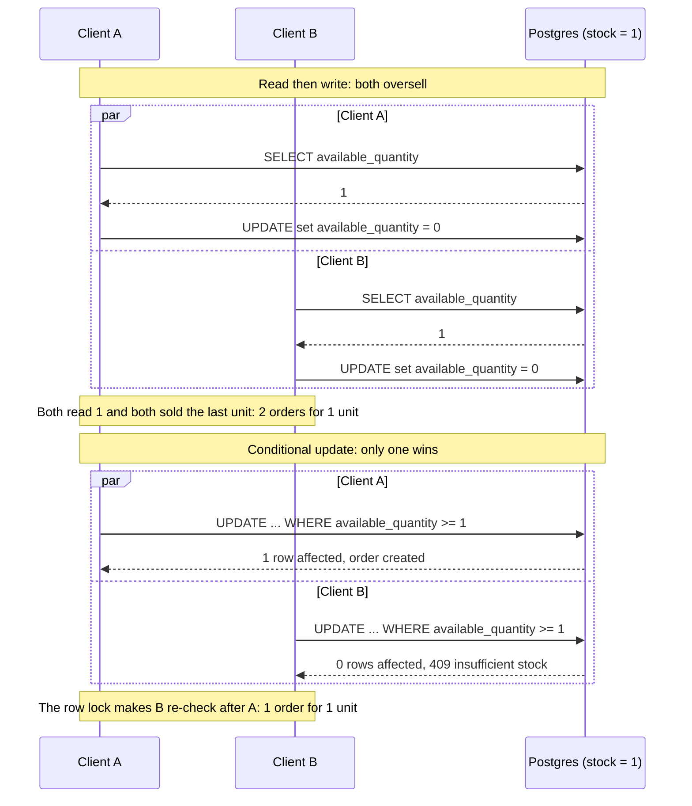

# 0005. Stock reservation by atomic conditional decrement

- Status: accepted
- Date: 2026-11-17

## Context

Many customers can try to buy the last units of a product at the same moment.
The system's central claim is that it never sells more than it has. The
reservation has to be correct under concurrency, not just in a single request.

## Decision

Reserve stock with one conditional statement, in the same transaction that
creates the order:

```sql
update products set available_quantity = available_quantity - :n
where id = :id and available_quantity >= :n
```

Zero rows affected means there was not enough stock, and the request is
rejected with `409`. Postgres takes a row lock for the update, so concurrent
updates on one product run one after another, and each one re-checks the
condition against the value the previous one left.

## The race this avoids



## Evidence

`OrderConcurrencyTests` starts 200 concurrent buyers, each ordering 1 unit of
a product with 50, through the real HTTP endpoint against a real Postgres
(Testcontainers). Measured on 2026-11-17: **50 orders created (`201`), 150
rejected (`409`), final stock 0, exactly 50 rows in `orders`**, in about 1.6 s.
The test runs in CI on every push.

## Alternatives

- **Pessimistic lock** (`select ... for update`, then update). Also correct,
  but it needs two statements and holds the row lock across the application's
  round trip between them. Under contention that serializes more work than the
  single statement does, and a forgotten lock or a different code path brings
  the race back.
- **Optimistic lock** (a version column, retry on conflict). Correct, but under
  heavy contention most attempts fail and retry, so the last units cost many
  wasted round trips and the code needs a retry policy with its own limit.
  It suits rarely-contended rows, which a flash sale is not.

## Consequences

- The invariant lives in one SQL statement, not in application logic, so it
  holds for every caller.
- Cancelling an order returns the stock with the mirror statement, in the same
  statement that moves the order out of `PENDING`, so it also happens once.
- A hot product serializes on its row. That is intended here; a much larger
  system would shard the stock or reserve in batches.
