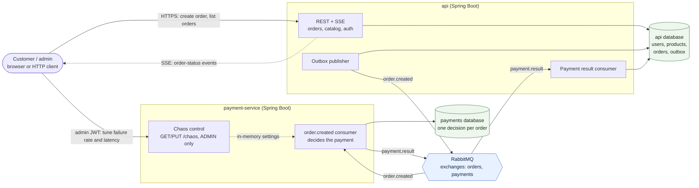
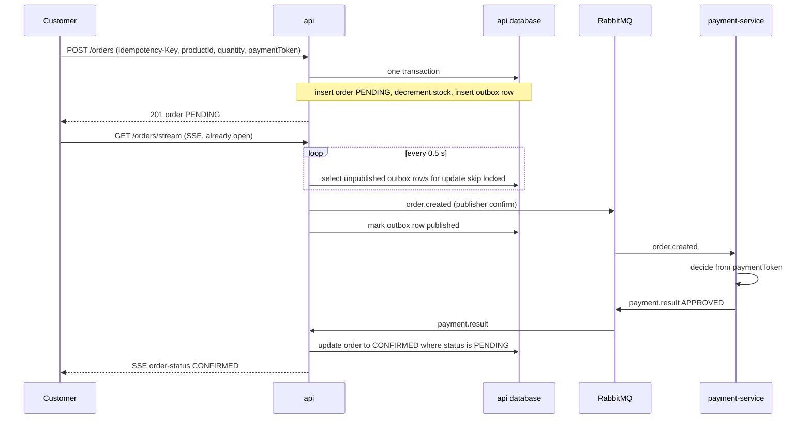
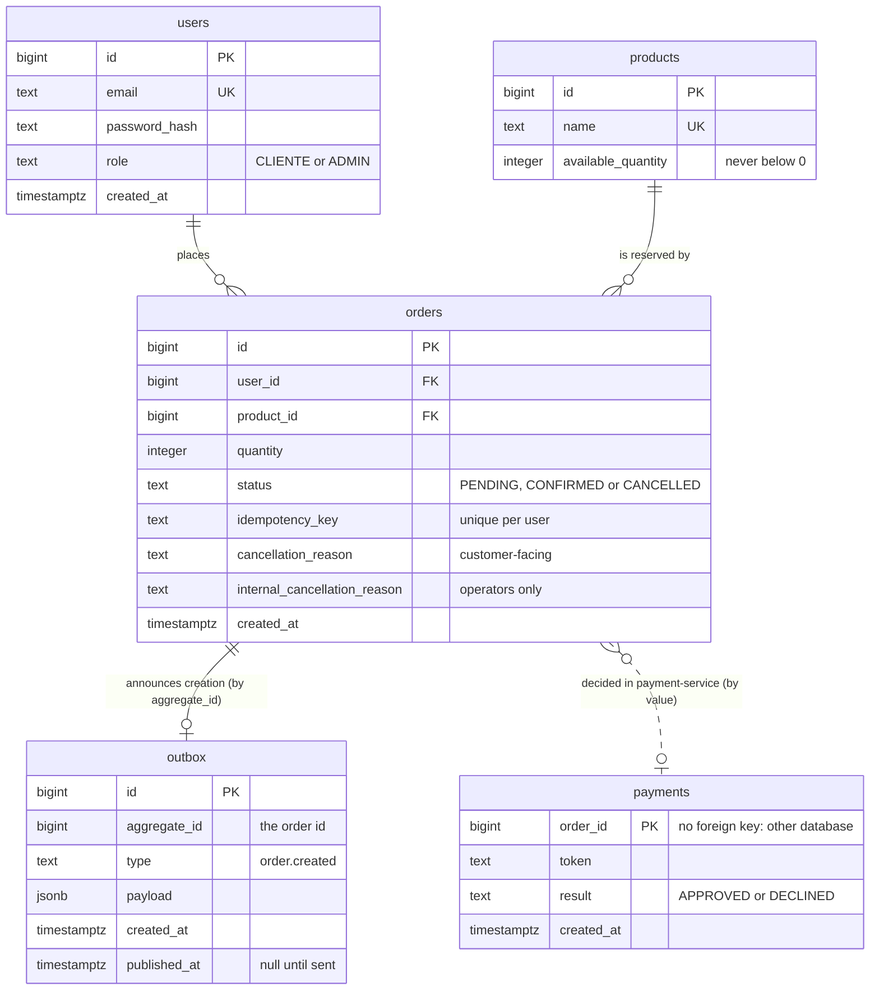
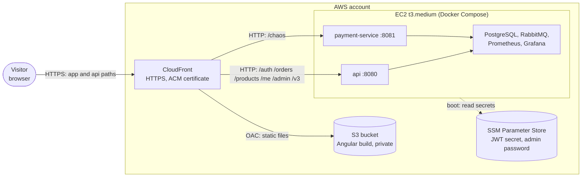

# Architecture

The backends, their databases and RabbitMQ are drawn here, with the order
lifecycle and the data model. The container view (web, Prometheus, Grafana) and
the full critical-flow sequence, with their sources, are in the
[README](../README.md#architecture). Decisions behind these pictures are in
[`docs/adr`](adr/); terms are defined in [`CONTEXT.md`](../CONTEXT.md).

## 1. System context

Two services, one database each, talking only through RabbitMQ
([ADR 0004](adr/0004-two-services-with-one-database-each.md)). The customer
talks only to `api`.

## 2. Order lifecycle, happy path

From the click to a confirmed order. The reservation and the outbox row commit
together ([ADR 0002](adr/0002-hand-written-transactional-outbox.md),
[ADR 0005](adr/0005-atomic-conditional-stock-decrement.md)); everything after
that is asynchronous. Declined, exhausted and expired paths are in
[ADR 0001](adr/0001-payment-retry-and-dlq-policy.md).

## 3. Data model

Two databases that share no tables. `orders.product_id` and `orders.user_id`
are real foreign keys inside the `api` database; `payments.order_id` only
refers to an order by value, because it lives in another service.

## 4. Deployment on AWS

What `terraform apply` in [`infra/terraform`](../infra/terraform) creates. Visitors only ever talk to CloudFront;
the instance admits only CloudFront's address range. The cost is about US$ 37 a month while it runs and zero after
`terraform destroy`.

